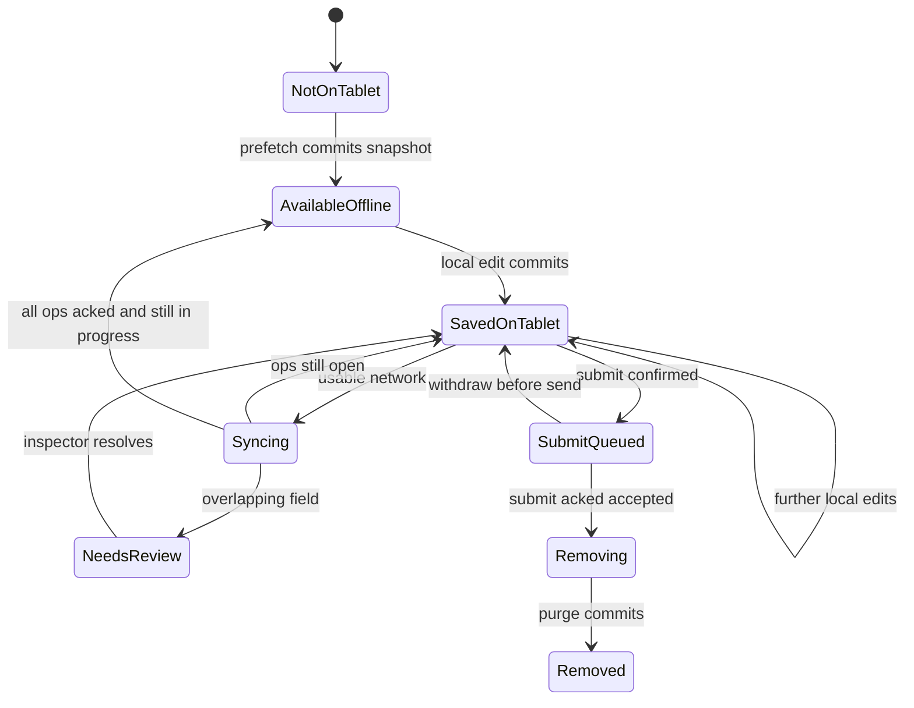

# Offline inspection sync

This plan makes assigned building inspections editable on company-managed tablets with no signal. The inspector can open a prefetched inspection, fill the form, take up to 40 photos, and collect a signature. Every edit commits to SQLite before any network call. When connectivity returns, even briefly, the tablet uploads an idempotent operation log and the photo and signature bytes to the existing versioned REST records. Non-overlapping edits from a supervisor on the web merge automatically. Overlapping fields pause that inspection and the inspector chooses the value. After the server durably accepts the signed submission, the tablet deletes local customer data.

The current failure (a dropped connection after open discards notes) is closed by the same path: the form becomes editable only after a local snapshot commit, and online use also writes locally first. Sync is not a second editor. There is no real-time co-editing.

This plan has no calendar dates and no staffing estimates. Order, dependencies, and exit criteria are the commitments. Adopting the plan adopts the recommendations below. Two items still need an explicit compliance confirmation before real customer data is piloted: the meaning of "accepted," and what the server audit record stores. Those are D1 and D9.

## Assumptions

Beliefs this plan depends on. A1–A3 are the ones most likely to force a redesign; they are summarized in `RESPONSE.md`.

| ID | Assumption |
| --- | --- |
| A1 | "Accepted" is the server transaction that commits this inspector's `submit`. Local customer data may remain on the tablet before that event. The 24-hour deletion duty is met by deleting as soon as the tablet learns of acceptance (normally in that same response), measured against server time. A tablet that never comes back online after a lost accept-response is covered by encryption plus remote wipe, which may be weaker than a strict wall-clock reading. |
| A2 | Inspection writes can be given a per-field modified version under the integer version the APIs already use. The web app saves a form the server can diff. Supervisors and inspectors overlap on individual fields often enough to matter and rarely enough that a manual resolve step is acceptable. The product constraint against a collaborative editor means we will not build character-level merge, presence, or live co-editing. |
| A3 | After leaving the basement, a pilot tablet normally gets enough connectivity the same shift to upload up to 40 photos and complete `submit`. Acceptance waits for those bytes, so customer data stays on the tablet until upload finishes. That delay is acceptable under A1. |
| A4 | Today's SQLite data is a read-through cache. It holds no unique notes. Upgrade may discard it. Notes already lost to disconnects before this ships are unrecoverable. |
| A5 | Forms are structured. Fields have stable ids. The pilot type set is text, long text, number, single select, multi select, boolean, date, plus inspection-level photos and one signature. |
| A6 | "A signature" is one inspector signature per inspection: a raster image, the signer display name, and a client timestamp. It is required to submit. It is not one of the 40 photos. |
| A7 | Assignments are created on the server. The tablet does not create inspections. The pilot is one inspector account per tablet. Unsupported extra writers (a second tablet) fall through the same conflict rules. |
| A8 | Company mobile-device management can require disk encryption, a screen lock, remote wipe, and no backup of the app sandbox. The OS photo library is not a storage location for captures. |
| A9 | The server keeps the regulatory audit history, including field values, on the server retention schedule. The 24-hour rule in the brief applies to data on the tablet. |
| A10 | Refusing to open an inspection that has no local snapshot is acceptable. A start-of-shift prefetch while the tablet still has signal is part of the job. |
| A11 | Auth is token-based. A bounded offline session can be added without a new identity system. |
| A12 | Clocks on tablets drift. Server time is authoritative for acceptance, purge, and audit order. Client timestamps are claims. |
| A13 | A feature flag can select pilot inspectors and devices. Shipping this does not require a new distribution channel. |
| A14 | The threat model is a lost or stolen tablet, a stale or replayed write, and ordinary network failure. The basement network is not treated as a separate hostile environment beyond TLS. |

Discovery at the start of milestone M1, from the current API rather than from this brief: which inspection resources exist, which of them already carry integer versions, which web write paths bump those versions, how photos are stored today, and how long tokens live. Where the code disagrees with A2 or A4, stop and revise this plan before pilot.

## Decisions required before implementation

Each recommendation is the option to build. Compliance must confirm D1 and D9 before real customer data is enabled. The other rows are explicit so they are not relitigated mid-build; an objection belongs in the M0 record.

| ID | Decision | Recommendation | Confirmation |
| --- | --- | --- | --- |
| D1 | What "accepted" means, and when the 24-hour local-deletion clock starts | The only transition into `accepted` is the server committing the assignee's `submit` in the same transaction as validation and the audit row. `accepted_at` is that server timestamp. Supervisor web saves may change fields while status is `assigned` or `in_progress`; they do not accept the inspection. The tablet purges customer content immediately when it has durably stored a `submit` result (including a duplicate retry) that says `accepted`. Startup finishes a purge that was already authorized by a stored accept result and interrupted. Startup does not purge merely because a `submit` request might have reached the server; that case syncs first and purges only from the stored or retried result. Withdraw submit is allowed only while the `submit` op is still `pending` and has never been sent. Once it is in flight, the tablet waits for the result. After accept, fixes happen on the server and are audited there; the tablet does not download the content again. Immediate purge is the default. A short on-device review window is allowed only if it ends by `accepted_at` + 24 hours in server time. | Compliance and product, before real customer data |
| D2 | How supervisor and inspector edits combine | Field-level optimistic concurrency on one integer inspection version. Non-overlapping fields both commit. Overlapping fields pause the inspection and the inspector resolves on the tablet. Photos merge by client-generated id. No collaborative editor, no last-write-wins of the whole inspection, no silent drop of either side. | Product, before M3 |
| D3 | How offline writes talk to REST | Add one idempotent sync request for the operation log and a separate resumable blob upload. Keep integer versions and the existing web REST writes. Both paths call one domain service that bumps the version and writes the audit row. | Adopting this plan |
| D4 | How long an inspector can work after the last online authentication | Editing of already prefetched inspections remains available for 12 hours after the last successful online authentication, then the app locks. Unlock to keep editing uses the device credential (PIN or biometric) and does not require the network. Sync requires a live token. Lock, sign-out, and token expiry do not delete unsent work. | Security and product; 12 hours is the default |
| D5 | How local data is protected and erased | Hardware-backed keystore holds a device key that wraps a per-inspection data key. Field values, header, photos, and signature are encrypted with that inspection key. Purge destroys the key and deletes the files and rows. MDM full-disk encryption remains mandatory and is not the only control. | Security, before pilot |
| D6 | Schema changes while a tablet is offline | Schema versions are immutable. An inspection stores the schema version it was prefetched with and keeps that version through accept. Newer schemas apply to inspections prefetched afterward. | Adopting this plan |
| D7 | Photo size | The cap of 40 is a hard client and server limit on non-deleted photos, signature excluded. Default capture processing: long edge 2048 px, JPEG quality 0.7, refuse a photo that is still over 3 MB after that. Refuse new captures when free space is under a configured floor; set the floor from the pilot tablet model during M2 and record it in the pilot checklist. | Engineering default; product may tighten the byte cap |
| D8 | Assignment removed, or inspection cancelled, while this tablet has unsent work | The server still accepts that inspector's pending field and photo ops, writes them into the record and the audit, and does not reopen a cancelled inspection or give the submitter accept rights after reassignment. `submit` from a non-assignee is rejected. After those ops are acknowledged, the tablet purges the local copy. The new assignee sees the delivered notes. If the server rejects the payload as invalid, the tablet keeps the data, shows "sync blocked," and does not delete it. | Product, before pilot |
| D9 | What an audit row contains | Every accepted mutation writes one audit row in the same database transaction as the version bump: actor, role, device id if any, op id if any, client timestamp if any, server timestamp, base version, new version, op type, field path if any, before value, after value. A failed audit insert rolls the mutation back. Analytics and client telemetry do not get values, names, addresses, or free text. Server retention of the audit log is unchanged by this plan. Historical edits from before the field map exists are not reconstructed. | Compliance, before real customer data |
| D10 | Kill switch | A per-inspector and per-device flag, default off. Off means the tablet enqueues no new offline ops and will not open the local-first form for new work. If an outbox is non-empty, the app keeps the sync path on and asks the inspector to upload. The flag does not delete local work. Pilot rollback uses the flag, not a binary downgrade. | Adopting this plan |
| D11 | Shared tablets | Pilot tablets are one inspector each. A second person signing in cannot read the first person's encrypted inspection data. Unsent work stays until the owning inspector signs back in and syncs, or until remote wipe. | Product; default stands for the pilot |

## User flow

Visible states on an inspection card and on the open form:

| State | Meaning |
| --- | --- |
| Not on this tablet | No snapshot yet. Not editable. |
| Available offline | Snapshot and pinned schema are stored. No local edits. |
| Saved on this tablet | Local commit succeeded. One or more ops are not acknowledged. |
| Syncing | A sync pass is in progress. |
| Needs review | This inspection is paused on an overlapping field. |
| Submitted, waiting to upload | `submit` is queued. Photos, signature, or earlier ops are still outstanding, or the network is down. |
| Removing local copy | Server has accepted. Purge is running. |
| Removed from this tablet | Customer content is gone. The card may show an opaque id and "Submitted." |

**Prefetch, online.** The inspector unlocks the tablet and the app. When the network is actually usable (a successful authenticated request, not merely a radio association), the app refreshes the session and prefetches every inspection assigned to that inspector: header, integer version, status, pinned schema, field map, attachment metadata. Photo bytes already on the server download until the free-space floor; metadata is still stored if bytes are skipped, and missing reference images show as placeholders. Each inspection that has a committed snapshot and its schema becomes "Available offline." Prefetch does not change server status.

**Open.** If no snapshot is stored, the form stays closed, including when the radio just failed mid-download. There is no empty editable form. If a snapshot exists, inputs enable only after that snapshot transaction is committed. Opening does not by itself enqueue an op.

**Edit, offline or online.** Field changes, photo capture, photo delete, and signature capture commit in a local transaction and show "Saved on this tablet" immediately. The 41st non-deleted photo is refused with the count visible (for example, "40 of 40"). The signature pad works offline. Replacing the signature before submit is allowed. Leaving the form, force-quitting, or rebooting does not drop committed work.

**Intermittent signal.** A sync pass runs when an authenticated request can get through, and again after a failure with backoff capped at 15 minutes plus jitter. The pass uploads ready blobs, pushes ready ops, then pulls. A drop mid-upload resumes the blob. A drop mid-batch retries the same op ids. The inspector can keep editing during sync.

**Supervisor edit.** The supervisor changes fields on the web. The server diffs the save, bumps the inspection version once, and audits the changed fields. On a later pull, fields the inspector did not change update quietly. Fields both sides changed move the inspection to "Needs review." The inspector sees, for each such field, the label, their value, and the supervisor value, and picks one or types a replacement. Other inspections keep syncing.

**Submit.** The inspector signs (if they have not) and confirms submit. The confirmation states that after the server accepts, this tablet will remove the inspection and further corrections happen with a supervisor. Local validation requires the pinned schema's required fields, a signature, and a photo count from 0 through 40 (and any schema minimum). Failure leaves the form open. Success queues `submit` and shows "Submitted, waiting to upload." While that op is still `pending` and unsent, the inspector may withdraw it and keep editing. After the first send, withdraw waits on the result: an accept purges, and a rejection returns the form to editing. The client sends `submit` only after that inspection's blobs are confirmed and its earlier ops are acknowledged.

**Accept and purge.** The successful `submit` response, or a retry that returns the original accept, switches the card to "Removing local copy" and purge runs immediately. The inspector sees "Removed from this tablet." They cannot reopen the content on the tablet.

**Reassignment or cancel.** If pull says the inspection is no longer theirs, or is cancelled, behavior follows D8. Clean local copies delete on that pull. Dirty copies stay visible as "sync required" until the delivery attempt finishes, then purge.

**Lock and sign-out.** After the offline session limit, or on sign-out, the form locks and customer content stays encrypted. Nothing is purged because of lock or sign-out.

## Scope boundaries

In this plan:

- Local-first open, form fill, up to 40 photos, and one signature for inspections assigned to the signed-in inspector and already prefetched.
- The same local-first write path when the network is up, so a drop after open cannot discard notes.
- Opportunistic, resumable, idempotent sync to versioned REST through one new sync API and blob upload.
- Field-level merge, with manual resolution of overlaps on the tablet.
- Server audit history for mutations, including those that were captured offline.
- Local purge of customer data after acceptance, and purge of a clean copy when the server reports accept, cancel, or loss of assignment.
- Migration of the existing SQLite cache into a durable outbox store.
- A pilot flag, kill switch, metrics, and the supervisor web server's version check and field diff. The supervisor interface stays a normal form save.

Outside this plan:

- Real-time co-editing, presence, shared cursors, character-level merge, and operational transforms.
- Creating, cloning, or deleting inspections on the tablet.
- A supported workflow of two tablets editing one inspection.
- Offline use for supervisors, or a supervisor tablet app.
- Video, chat, and floor-plan markup.
- A new public API style for the web. Existing REST stays.
- Changing how long the server keeps audits or inspection records.
- Editing an inspection on the tablet after accept.
- Peer-to-peer sync between tablets.
- Recovering notes the current cache already lost.
- A general offline mode for the rest of the mobile app.

## Local data model

SQLite remains the only local database. Its role becomes: replica of prefetched server state, working copy, and outbox. Photo and signature bytes live as encrypted files in the app sandbox, referenced by the database, excluded from the system photo library and from device backup. User-data transactions use SQLite's full synchronous mode. The database user version gates migrations.

Customer content (header, field values, photo bytes, signature bytes, signer name, address, names) is encrypted with the per-inspection key from D5. Operational columns (ids, versions, states, timestamps, error classes) are not a license to copy values into them.

### `device_sync`

One row. `device_id` (stable, created on first launch, stored with the keystore material), `pull_cursor`, `server_time_offset_ms`, `last_online_auth_at`, `schema_catalog_version`.

### `schemas`

Primary key `(schema_id, schema_version)`. Immutable `body_json` encrypted: field path, type, required flag, label, options, optional `min_photos`. Fetched at.

### `inspections`

Primary key `inspection_id`. `server_version` (integer last applied), `status` (`assigned`, `in_progress`, `accepted`, `cancelled`), `schema_id`, `schema_version`, `assignee_id`, `header_encrypted`, `accepted_at` (server time, nullable), `local_phase` (`clean`, `editing`, `conflict`, `submit_queued`, `purge_pending`, `purged`), `purge_deadline` (server `accepted_at` + 24 hours, nullable), `purged_at`, `dek_id` (null once the key is destroyed). Header is server-owned display data (site label and address) and is replaced on pull. Inspector edits go through schema fields.

### `fields`

Primary key `(inspection_id, field_path)`. `server_value_encrypted`, `server_field_version` (integer), `local_value_encrypted`, `dirty`, `conflict_server_value_encrypted` nullable. A dirty field still holds `local_value` after a pull. Purge nulls both value columns.

### `attachments`

Primary key `client_id` (UUID). `inspection_id`, `server_id` nullable, `kind` (`photo` or `signature`), `field_path` nullable (a photo may illustrate one question), `sha256`, `byte_size`, `local_relpath` nullable, `upload_state` (`pending`, `uploading`, `confirmed`, `remote_only`, `purged`), `captured_at_client`, `tombstone`. Active photos are `kind = photo` and `tombstone = 0`. Their count is at most 40. Active signatures are at most one.

### `outbox`

Primary key `op_id` (UUID). `inspection_id`, `seq` (null until first send; then a per-device monotonic integer, never reused or reassigned), `op_type` (`upsert_field`, `add_photo`, `delete_photo`, `set_signature`, `submit`), `field_path` nullable, `attachment_client_id` nullable, `base_version` integer, `payload_encrypted`, `payload_sha256`, `state` (`pending`, `inflight`, `acked`, `conflict`, `rejected`, `superseded`), `attempt_count`, `last_error_class`, `created_at_client`.

`seq` is assigned in send order when an op first enters `inflight`, and only for ops that are actually sent. A pending op with a null `seq` can be updated or removed without leaving a gap. Payload and `seq` are immutable once state has been `inflight`. A later edit to the same field while the op is still `pending` with a null `seq` updates that row in place (same `op_id`, new payload and hash). After the first send, a further edit is a new op. Among live ops on an inspection, `submit` is last in send order. Withdrawing submit deletes that row only while it is `pending` with a null `seq`, and returns `local_phase` to `editing`.

### `blob_jobs`

Primary key `client_id`. `bytes_confirmed`, `attempt_count`, `last_error_class`. Independent of outbox order so a large photo does not sit in front of a text field at the server. The `add_photo` or `set_signature` op is eligible to send only after `upload_state = confirmed`.

### `sync_receipts`

Primary key `op_id`. `inspection_id`, `result` (`applied` or `rejected`), `result_version`, `server_time`. No field values and no names. Written when an op reaches a terminal server result. Survives purge so support can see that work was acknowledged. Retain 45 days, then delete. This table is operational, not the regulatory audit.

### Invariants

- The form cannot enter an editable state unless an `inspections` row and its schema row are committed and `status` is `assigned` or `in_progress` and `local_phase` is not `purged`.
- A local content change and its outbox row commit in one transaction. The file for a new photo is durably written before that transaction references it. Startup deletes unreferenced temp files.
- Purge runs only when `status` is `accepted` (or D8's delivery has fully acknowledged, or the copy is clean and the server has dropped it) and no live outbox rows or unconfirmed blobs remain for that inspection.
- After `purged_at` is set, header, field values, attachment rows' paths, signer name, and the inspection key are gone.
- Client telemetry never selects encrypted columns.

## Sync protocol

Delivery is at least once. Effect is exactly once per `op_id`. The server stores `op_id` and `payload_sha256` in the same transaction as the mutation. A repeat with the same id and hash returns the original result and does not bump the version again. A repeat with the same id and a different hash is `rejected` with `payload_mismatch` and is not applied.

### Resources the server maintains

These fit the existing integer versions. M1 maps them onto the current routes.

- **Inspection.** Integer `version`. Status. Assignee. Schema id and version. Header.
- **Field map.** `field_path → {value, modified_version}`. `modified_version` is the inspection version at which that field last changed. Initial backfill sets every field's `modified_version` to the inspection's current version.
- **Attachment metadata.** Client id, server id, kind, checksum, byte size, optional field path, tombstone, inspection version at which it was added or tombstoned.
- **Blob store.** Bytes addressed by server attachment id, checksum verified, not publicly readable.
- **Processed ops.** `op_id`, payload hash, result, resulting version. Retained at least 45 days and at least until the device has purged or the inspection has been accepted for 45 days, whichever is later.
- **Audit log.** As in D9.

All of these writes for a single op go through one domain service used by the sync API and by the existing web REST handlers. Web saves send the inspection version they displayed. The server rejects a stale web write. The web client refreshes and the supervisor retries. The server diffs a successful web save against the field map, updates only changed paths, bumps `version` by one, and writes audit rows for the changed paths.

### Push

`POST /v1/inspection-sync`, authenticated.

Request body:

- `device_id`, `client_time`
- `push`: an ordered list of ops the client believes are eligible. Each op: `op_id`, `seq`, `inspection_id`, `base_version`, `op_type`, `field_path` if any, `attachment_client_id` if any, `payload`, `payload_sha256`, `client_ts`
- `pull`: `cursor` (opaque, nullable), `held_inspection_ids` (ids currently stored on the device), `known_schemas` (`schema_id`, `schema_version`), `limit`

The client sends at most 50 ops or 256 KB of JSON, whichever comes first. A send batch is a creation-order prefix of the live ops on that inspection. As those ops enter `inflight`, each null `seq` is set from the device counter. The client does not put an op in the batch until:

- every earlier live op on that inspection is already terminal or sits ahead of it in the same batch, and
- for `add_photo` and `set_signature`, the blob checksum is already confirmed, and
- for `submit`, every other live op on that inspection is acknowledged and every active attachment blob is confirmed.

The server processes `push` in list order, locking each inspection row. For each op:

| Condition | Result |
| --- | --- |
| `op_id` already stored with the same hash | `duplicate` and the original result. Version unchanged. |
| `op_id` stored with a different hash | `rejected` / `payload_mismatch`. |
| A smaller `seq` from this `device_id` for this inspection was never stored and is not earlier in this request | `blocked` / `sequence_gap`. Later ops for that inspection in this request are not attempted. |
| `op_type` is `upsert_field` or `delete_photo` or `set_signature`, and the target's `modified_version` is greater than `base_version` | `conflict`, including server version, field path, and server value. The op id and `seq` are stored as a terminal `conflict` result so the sequence is consumed and a retry returns the same result. The field is not changed, the version is not bumped, and no before/after audit row is written. |
| `op_type` is `upsert_field` and `modified_version` ≤ `base_version` | Apply value, set field `modified_version` and inspection `version` to the new version, audit, store op, `applied`. If status is `assigned`, set `in_progress`. If status is `cancelled`, keep `cancelled`. The actor does not have to be the current assignee (D8). |
| `add_photo` and the client id is new, checksum matches a stored blob, active photo count after add ≤ 40 | Apply metadata, bump version, audit, `applied`. |
| `add_photo` and that client id is already stored with the same hash | `applied` idempotent result. No second photo and no version bump. |
| `delete_photo` of a known id whose attachment `modified_version` ≤ `base_version` | Tombstone, bump version, audit, `applied`. A repeat tombstone is an `applied` no-op. |
| `set_signature` and the slot's `modified_version` ≤ `base_version`, checksum matches a stored blob | Store the signature metadata, bump version, audit, `applied`. |
| `set_signature` and the blob is not durable yet | `blocked` / `attachment_not_ready`. The id and `seq` are not consumed. |
| `add_photo` and the blob is absent or checksum differs | `blocked` / `attachment_not_ready` or `rejected` / `checksum`. Not stored as a final rejection if the blob is simply not durable yet (`attachment_not_ready` is retryable and does not consume the id). |
| `add_photo` would make 41 active photos | `rejected` / `photo_limit`. |
| `delete_photo` of an unknown id | `applied` no-op if the tombstone is already there or the id was never accepted; otherwise `rejected` / `unknown_attachment`. |
| `submit` and actor is the current assignee, status is `assigned` or `in_progress`, signature blob is durable, required fields pass, active photos ≤ 40 and ≥ schema minimum, no referenced blob missing | Set `accepted`, set `accepted_at` to server now, bump version, audit, `applied`. |
| `submit` and a precondition fails | `rejected` with a stable code (`not_assignee`, `bad_status`, `signature_required`, `field_required`, `photo_limit`, `blob_missing`). The id and `seq` are consumed so the same broken payload is not reapplied. The client must enqueue a new `submit` after fixing local state. |

A conflict or a terminal rejection does not roll back earlier ops in the batch that already applied. Terminal results (`applied`, `conflict`, `rejected`, and the stored result behind `duplicate`) consume `op_id` and `seq`. Retryable `blocked` results, including `attachment_not_ready` and `sequence_gap`, do not. The response lists one result per attempted op. HTTP 200 carries per-op results. Authentication runs before any apply. HTTP 401 means the token is dead and nothing in that request was applied. A 5xx means the client retries the same ids and the same seqs; anything not committed was not stored.

`base_version` is the inspection `version` the edit was based on, not a per-field guess by the client. The server compares that number to the **field's** `modified_version` (or the attachment's modified version). An inspection version that moved because some other field changed is not a conflict.

The same status rule applies to an applied `add_photo`, `delete_photo`, and `set_signature`: `assigned` becomes `in_progress`, and `cancelled` stays `cancelled`.

### Pull, in the same response

- `server_time`
- `next_cursor`
- `changed`: inspections newly assigned or updated since the cursor and still relevant to this user. Each includes id, version, status, assignee, schema id and version, `accepted_at` if set, header, full field map (path, value, modified version), attachment metadata. No blob bytes.
- `dropped`: held ids that are no longer assigned to this user, or are `cancelled` or `accepted`, if they were not already fully described in `changed`. Reason code included.
- `schemas`: bodies the client asked for by omission from `known_schemas` and that the changed inspections need.

The client stores `next_cursor` only in the same local transaction that finishes applying the page. Replaying a page is safe: a field snapshot at a given version applied twice matches.

Pull application while local work exists:

- Not-dirty field: replace local and server shadows with the pulled value.
- Dirty field whose pulled `modified_version` ≤ the pending op's `base_version`: keep the local value. Update the inspection's `server_version` only as a high-water mark. Do not rewrite the op's `base_version`.
- Dirty field whose pulled `modified_version` > the pending op's `base_version`: keep the local value, store the server value on the conflict column, set `local_phase = conflict`, stop pushing further ops for this inspection until resolution.
- Do not clear a dirty value because the inspection version increased.

Client send order in a pass: confirm blobs that are ready (limited parallelism, two at a time), push eligible ops, then apply the pull section of the response. If a push result is `conflict`, apply it before using the pull to fill the review screen.

Backoff uses `last_error_class`. `sequence_gap`, `attachment_not_ready`, and network failures are retryable and keep the assigned `seq`. `payload_mismatch` pauses further pushes for that inspection until the op is superseded by a new op id; it must not be skipped. A validation `rejected` on `submit` returns the form to editing. Other terminal rejections surface "sync blocked" on that inspection.

### Blob upload

1. `POST /v1/inspection-attachments` with `client_id`, `inspection_id`, `kind`, `sha256`, `byte_size`, `content_type`. Response: `server_id` and a short-lived upload instruction bound to that id. Repeating the same `client_id` and hash returns the same `server_id`.
2. Resumable byte upload. The server records the contiguous confirmed prefix.
3. `POST /v1/inspection-attachments/{server_id}/complete` with the hash. The server checks the stored bytes. Mismatch deletes the partial and returns `checksum`. Match sets the blob durable.

Upload instructions expire; the client requests them again and resumes. Bytes are not fetched by unauthenticated URLs.

### Resolution rewrite

When the inspector finishes the review screen, the client, in one transaction:

- For each conflicted field, if they kept the server value, drops the local dirty value and supersedes the unapplied op.
- If they kept theirs or typed a new value, supersedes the unapplied op and inserts a new `upsert_field` whose `base_version` is the pulled inspection version and whose payload is the chosen value.
- Leaves unapplied ops for fields the server did not change, still with their original `base_version`.
- Clears `local_phase` to `editing` once no conflict columns remain.

A superseded `op_id` is not sent again. If the server already stored it as `conflict`, that terminal result stays, and the replacement is a new `op_id` with a new `seq` assigned when it is sent. Applied ops stay applied. This is a rebase of unacknowledged work.

### Time

Each successful sync stores `offset = server_time - device_clock`. Purge deadlines use `accepted_at` from the server. Audit order uses `server_time`. Client timestamps are stored beside it. The server still accepts an op whose `client_ts` is implausible; it records the claim and sets an `implausible_client_time` flag on the audit row. It does not reject the inspection for clock skew.

## Conflict policy

One writer is supported on the tablet, plus supervisors on the web. That is the overlap the product has to survive without becoming a collaborative editor.

Rules:

- The unit of conflict is one field path, one signature slot, or one photo identity.
- Text is not merged inside the string. If both sides changed the same field, the inspector picks the whole value.
- Photo adds with distinct `client_id`s all stay. Deletes are tombstones. Two deletes of the same id are one delete. A delete conflicts only if that attachment's metadata modified version is newer than `base_version` and the server state is not already the tombstone the client is trying to write.
- The signature is one slot. The same rule as a field applies. The later resolved `set_signature` is the signature that `submit` requires.
- The photo cap is enforced at add time and again at `submit`. A merge that would exceed 40 rejects the op that crosses the cap; the inspector deletes down and retries with a new op.
- Conflict pauses push for that inspection only.
- The web client does not grow a merge UI in this plan. A stale supervisor save fails the version check; the supervisor reloads the form, which by then includes any ops already applied, and saves again.
- Unknown schema types: the inspection is readable where the app understands it, and `submit` stays disabled with "Update the app to submit this inspection." The client does not drop unknown fields on sync.

Worked example. Tablet pulled version 3. Supervisor sets field A; server version is 4; field A `modified_version` is 4; field B remains at 2. Tablet, still based on 3, sets field B and field A.

- Field B applies, because 2 ≤ 3. Inspection version becomes 5. Both the supervisor's A and the inspector's B are stored.
- Field A returns `conflict`. The tablet shows the supervisor's A and the inspector's A. Nothing in that op was written.

## Attachments

- Captures go to the sandbox through the encrypted file path. They are not written to the shared photo library. Share-sheet and screenshot export of an inspection are disabled where the platform allows, and the pilot device profile turns them off.
- A photo row is created only after the file is durable. The outbox `add_photo` follows blob confirmation, so the server does not audit a photo it cannot read.
- Deleting a photo whose `add_photo` op is still `pending` with a null `seq` removes the local file, the blob job, and that op. No server op. Once the op is in flight, the tablet waits for the result and then sends `delete_photo` if the add was applied.
- Deleting a photo already applied enqueues `delete_photo`.
- The signature uses the same blob path with `kind = signature` and is not counted toward 40. Photos that originated on the web count toward the same cap of 40.
- Checksums are SHA-256 computed on device before upload. The server recomputes.
- Interrupted uploads resume from `bytes_confirmed`.
- Reference images that originated on the server are prefetched best-effort. Failure to fetch a reference image does not block form fill or submit.
- Disk pressure: stop new captures under the free-space floor, keep the outbox, and show why. Do not delete queued customer data to free space.
- `submit` is the completeness gate. The server accepts only when every referenced blob is durable. Until then the tablet retains the local copy and shows "Submitted, waiting to upload."

## Security

- Pilot enrollment requires the MDM baseline in A8: device encryption, screen lock, remote wipe, backup of the app data store disabled, OS version on a floor the app already supports.
- The app holds session tokens in the platform keystore. The offline window follows D4. After 12 hours without online authentication the UI locks. Data and outbox remain. Sync that receives 401 locks the sync action, keeps the outbox, and asks for online sign-in.
- Each inspection's field values, header, and files use a distinct data key wrapped by a hardware-backed device key. Purge deletes the wrapped key first, then rows and files, inside the purge transaction's cleanup. Flash wear means overwrite is not the control; destroying the key is.
- SQLite, its journal and WAL, temp capture files, and thumbnails are covered by the same key and the same purge file list. Startup removes temp files with no attachment row.
- TLS for every sync and upload call. This plan does not add certificate pinning; a pinned key plus a wrong device clock is a way to trap a tablet that cannot sync, which fights the deletion requirement. If the app already pins, keep the existing policy and test clock skew explicitly.
- Upload URLs are authenticated and short-lived. Blob reads for prefetch use the same session.
- The server rejects a mutation it cannot audit (D9). There is no admin path that updates an inspection field without the domain service.
- `device_id` is an audit and support attribute, not a proof of identity. Identity is the user token. Ops name the user from the token, and the device id from the body, and the server stores both.
- A jailbroken or rooted device is recorded as a signal on sync and excluded from the pilot cohort. It is not the only control.
- Telemetry, crash logs, and support exports omit header text, field values, signer names, addresses, photo bytes, and signature bytes. They may include inspection id, op id, versions, op type, error class, byte counts, and device id.
- Lost tablet: MDM remote wipe remains the control for a device that will not sync. Local data is unreadable without the device key and the lock credential. That is the residual case named under A1.
- The server audit log holds customer values because D9 says reconstruction is the point of the audit. Access to audit rows follows the same staff authorization as the inspection record. This plan does not copy that log onto the tablet.

## Migration and backfill

**Tablet.** On first launch of the build that contains this store:

- Read the SQLite user version.
- Create the new tables beside the old cache.
- Do not copy cache rows into `fields`, `attachments`, or `outbox`. A4 says they are not unique work, and promoting them would manufacture false dirty state.
- Drop the cache tables once the new schema is committed, or leave them unread if a later binary still needs to open the file during rollback testing. They are not a source of truth either way.
- Set a local "prefetch required" bit. Until one successful prefetch completes, every assigned inspection renders as "Not on this tablet," including if the radio is down. The inspector sees that offline work is unavailable until the tablet has synced once on this version.
- If the upgrade transaction fails, the app stays on the online read-through behavior and reports the migration error. It does not half-open the new form.

**Server, before any pilot device can enqueue an op.**

- Ensure every inspection row has an integer `version`, backfilling missing values to 1.
- Build the field map from the current stored form. Set each `modified_version` to that inspection version. Write one audit event `field_map_baseline` with actor `system` and no per-field before/after dump (the current row remains the current value; this plan does not invent a history the old system did not store).
- Add processed-op storage, attachment client ids and checksums, and the audit columns in D9.
- Route existing web writes through the domain service. Confirm there is no second writer that updates inspection columns directly.
- These server changes are safe while the client flag is off: behavior for a web save that does not touch fields is a version bump only when the diff is non-empty. A stale write newly returns a version conflict instead of overwriting. That is intended.

**Rollback of the migration.** A forward migration that discarded the cache can be followed by an app downgrade only when every pilot device outbox is empty. The downgraded app may recreate a cache by refetching. It must not be pointed at the new tables and interpret them as the old cache.

## Observability

No metric label or log property may contain customer content. Allowed dimensions: app version, cohort, op type, error class, HTTP class, platform.

Client:

- Sync pass result and error class.
- Outbox depth and age of the oldest live op.
- Blob failures, retries, and bytes confirmed.
- Conflict count, by inspection, without field path in the metric (field path may sit in access-controlled server logs).
- Purge result: `purged`, `overdue`, `blocked_unsent`.
- Prefetch: inspections stored, inspections skipped for space, schema missing.
- Photo-count histogram at submit time (counts only).
- Offline session length.

Server:

- Op apply latency, duplicate rate, conflict rate, rejection codes.
- Web version-conflict rate (stale `If-Match` or equivalent).
- Audit transaction rollback count. Page on any non-zero rate; a mutation that cannot audit is a failed mutation, and a rising count means inspectors cannot save.
- Blob complete failures and checksum failures.
- Time from `accepted_at` to device-reported purge, for devices that have reported.

Alerts for the pilot:

- Audit rollback count > 0 in a five-minute window.
- A device that has pulled `accepted_at` and has not reported purge, and whose `accepted_at` is older than 24 hours.
- Outbox age over 8 hours while the device is completing other authenticated requests (stuck queue, as opposed to a basement).
- Sync error rate excluding `conflict` and user-caused `rejected` above the dogfood baseline by a sustained margin. Set the numeric page threshold from dogfood rates before the pilot cohort expands; do not invent the threshold here.

Support can read, for an inspection id: op ids, states, versions, error classes, accept time, purge time. They cannot read field values from telemetry. Server inspection and audit screens remain the place to see content, under existing staff access.

The pilot dashboard shows cohort size, inspections submitted through the local-first path, conflict rate, purge lag, stuck outbox count, and open data-loss incidents. It does not show customer fields.

## Staged rollout

Stages are ordered. Exit criteria are the gate. There is no date on any stage.

**Stage 0 — server dark.** Ship field map, domain service, audit transaction, blob API, and sync API to production with the client flag off for everyone. Web saves go through the domain service. Exit: web saves bump version and write field-level audit; a deliberately stale web write is rejected; processed-op replay in a production-like environment does not double-apply; no client has the flag.

**Stage 1 — synthetic dogfood.** Flag on for staff accounts and non-customer inspections only, until D1 and D9 are confirmed. Script the basement case: prefetch, radio off, edit, photos, signature, kill app, reboot, radio on, accept, purge. Exit: the script passes on the pilot hardware; migration from a cache build does not present cache rows as dirty; kill switch drains a prepared outbox and then blocks new local-first opens; telemetry sample contains no field values.

**Stage 2 — pilot cohort.** Product names the inspectors and devices. Real assignments. Support has the state table in this plan. Exit, all of them:

- No open incident where a committed local note was lost because of connectivity.
- Every accepted inspection whose tablet completed a sync within 24 hours of `accepted_at` shows a purge reported inside that window.
- Any accepted inspection that missed the window has a written compliance disposition before the cohort grows.
- Conflicts that occurred were resolved on the tablet, or are listed as product issues with a decision to continue or stop.
- Photo `rejected` / checksum / permanently failed upload count is understood. A permanent failure rate above 2% of photos in the cohort stops expansion until the cause is fixed. (This threshold is a pilot gate, not a capacity plan.)
- Audit rollback alert has stayed at zero.
- The kill switch has been exercised once in dogfood and the runbook matches what the device did.

**Stage 3 — broad company rollout.** Flag default on for devices that meet the MDM bar. The kill switch stays. Exit: stage 2 criteria hold for the first broad slice the same way, and the online read-through write path is no longer reachable from the inspection form.

**Stage 4 — cleanup.** Remove unread cache code and any duplicate write path. Sync API and web REST still share the domain service.

Stop the rollout and return to the flag-off posture (draining existing outboxes) if audit rollbacks are non-zero, if a purge gap has no compliance disposition, or if a confirmed data-loss bug is open.

## Rollback

- **Flag off** is the rollback. Tablets with an empty outbox behave as online read-through again and do not open a half-cached form as editable. Tablets with a non-empty outbox keep uploading until it is empty or until an op is `rejected` or `conflict`, which support handles from the state table. The flag never deletes the outbox.
- **Server endpoints stay up** while any client might still push. Disabling the route while outboxes are dirty strands customer data on tablets and fights D1. The dark behavior is "no new clients enqueue," which is the flag, not an API outage.
- **Do not ship a binary downgrade** to a device with live outbox rows or unconfirmed blobs. The old binary does not know how to upload them. If a binary rollback is ever required, drain first, then downgrade, then let the old app refetch a cache.
- **Bad server apply.** Because every apply stored the op payload hash and the audit before/after, an inspection's field map can be rebuilt to a prior version by replaying audit rows forward from `field_map_baseline` or by reversing a single audited op under a new compensating op. Compensating ops are a support tool using the domain service, so they are themselves audited. They are not a tablet feature.
- **Purge bug that deletes before ack.** Treat as data loss. Stop the cohort via the flag. Do not tell inspectors to keep working offline until the purge guard is fixed and tested.

## Testing

Tests are part of the milestone that introduces the behavior. A milestone is not done while its rows fail.

| Case | Pass | Milestone |
| --- | --- | --- |
| Prefetch, enable radio off, edit three fields, kill app, reboot, radio still off | Values present and marked saved on tablet | M2 |
| Radio dies after open, before any explicit save gesture | Edits made after the snapshot commit are present | M2 |
| Upgrade from a cache-populated build | New store empty of dirty fields; inspections not editable until prefetch; cache text does not appear as a local edit | M2 |
| 41st photo | Refused; first 40 remain | M2 |
| Submit with a required field empty or signature missing | Submit not queued; form remains editable | M2 |
| Queue submit, withdraw before the op is sent | Submit op gone; editing restored. Withdraw is unavailable while the op is in flight | M2 |
| Blob upload interrupted at a known byte offset | Resumes; one blob; checksum matches | M2 |
| Same `op_id` and hash delivered twice | One version bump; second result `duplicate` | M1 |
| Same `op_id`, different hash | No apply; `payload_mismatch` | M1 |
| Supervisor changes field A, offline inspector changes field B, then sync | Both values stored; one new version for B on top of A | M1, M3 |
| Both change field A | A's op is `conflict`; B's non-overlapping op can still apply; tablet shows A for resolution; chosen value syncs as a new op | M1, M3 |
| Property check: random field sets from both sides | Every non-overlapping field survives from both writers; an overlapping field is never stored from both without a resolution op | M1 |
| Web save with a stale version | Rejected; reload then save applies; no direct SQL writer bypasses this | M1 |
| Audit insert forced to fail | Field unchanged, version unchanged, op not stored | M1 |
| `submit` with a missing blob, then complete the blob and retry | First result does not accept; after the blob is durable, accept happens once | M1, M4 |
| Lost HTTP response after a committed `submit` | Retry returns `duplicate` and the original `accepted_at`; tablet purges once | M4 |
| Accept response applied locally | Header, fields, files, thumbnail, and data key unreadable; `sync_receipts` has no values | M4 |
| Device clock set backward across purge | Purge still happens from server `accepted_at`; deadline does not move with the device clock | M4 |
| Reassignment with a dirty field | Field is audited on the server; assignee can see it; old tablet purges after ack; old tablet's `submit` is `not_assignee` | M1, M3 |
| Cancel with a dirty field | Content op audited; status stays cancelled; tablet purges after ack | M1 |
| Token expired offline | Edits within the 12-hour window still commit locally; sync does not start until online auth; data still present | M2 |
| Sign-out | Next user cannot read the inspection; previous outbox still there after the owner signs back in | M2, M5 |
| Flag turned off with a non-empty outbox | No new ops; existing ops upload; then the form is online-only | M5 |
| Telemetry and crash payload from a sync with text, a photo, and a signature | Payload has ids, versions, counts, and error classes only | M5 |
| Disk full | Capture refused; existing outbox intact | M2 |
| Unknown future field type marked required | Submit disabled; known fields still sync | M3 |
| Schema version pinned | A newer published schema does not change an in-progress inspection's local form | M2 |

Also run the merge and purge tests under a proxy that drops connections after the server has committed and before the response, and again mid-blob.

## Milestones

Dependencies are the schedule. M1 and the local capture portion of M2 can proceed in parallel once M0 has recorded the engineering defaults. Real customer data waits on compliance confirmation of D1 and D9.

| Milestone | Depends on | Work | Acceptance |
| --- | --- | --- | --- |
| M0 — decision record | None | Record adopt or override for D1–D11. Name the compliance owner for D1 and D9. Inventory current REST resources, version columns, and write paths (the M1 discovery). | The decision table has a status for every row. Any override is written into this plan before code that would contradict it. Gaps found in the API inventory are listed as M1 tasks. |
| M1 — server domain path | M0 | Field map and baseline backfill. Domain service. Web writes use it and honor integer versions. Audit transaction. Processed ops. Blob initiate, resume, complete. `POST /v1/inspection-sync` as specified. Flag still off for customer devices. | M1 rows in the test table pass. A replayed op does not double-apply. A non-overlapping pair merges. An overlapping pair conflicts. A forced audit failure leaves the record unchanged. A stale web write is rejected. No unversioned writer remains. |
| M2 — tablet local-first store | M0 for capture and schema; frozen M1 request shape before the sync client is finished | New SQLite store, migration that discards cache-as-truth, encrypted files, outbox, coalescing of unsent field ops, photo and signature capture, caps, prefetch, sync worker, submit and withdraw. Flag off in production. | M2 rows in the test table pass on a tablet build. The disconnect-after-open case retains notes. An inspection with no snapshot is not editable. |
| M3 — conflicts and assignment changes | M1, M2 | Review screen. Pull application rules. D8 delivery. Submit lock while a conflict is open. | M3 rows pass. An inspector can resolve an overlap without a support tool. A second inspection on the same tablet keeps syncing while the first is in review. |
| M4 — purge | M1, M2, and a recorded D1 | Immediate purge once an accept result is stored locally. Startup finishes an interrupted purge. A lost accept response is recovered by retrying `submit`, then purging from that stored result. Crypto-erase, backup exclusion, purge metrics. | M4 rows pass. A test that plants an accepted inspection with an unacknowledged op does not purge. A lost response purges only after the duplicate result is stored. Customer bytes are unreadable after the successful path. |
| M5 — operate it | M1–M4 | Metrics, pilot dashboard, alerts, kill switch behavior, support notes that use the state table in this plan. | M5 rows pass. A sampled telemetry payload has no customer content. Flag-off drain matches the rollback section. The audit alert fires in a forced failure test. |
| M6 — dogfood then pilot | M5; D1 and D9 confirmed before real customer data | Stage 1, then stage 2, using the exit criteria in staged rollout. | Each stage's exit criteria are recorded as met or the cohort is stopped. No calendar commitment. |
| M7 — broad rollout and path removal | M6 exit | Stage 3 and stage 4. | The inspection form has a single write path: local commit, then sync. The read-through write path is gone. The kill switch still drains and disables. |

M0 does not end by silence. Unconfirmed D1 or D9 blocks M6's real-customer stage and does not block synthetic M1–M5.

## Residual risks the milestones do not remove

- A tablet that commits `submit` on the server, loses the response, and never powers on again still holds encrypted customer data past 24 hours until someone wipes it. A1 states this residual explicitly.
- A long period with no usable uplink delays acceptance itself, so the local copy remains by design (A3). The dashboard's outbox age is how that is seen.
- Two tablets for one inspector are unsupported. The second device produces ordinary conflicts, which are easy to misread as data loss if the pilot ignores A7.
- Server audit rows contain customer values for as long as the server retention schedule says. That is D9, and it is a different store from the tablet.
- Compensating a bad apply repairs server state. It cannot repair a tablet that already purged, because the tablet no longer has a copy. Post-accept corrections stay on the server.
