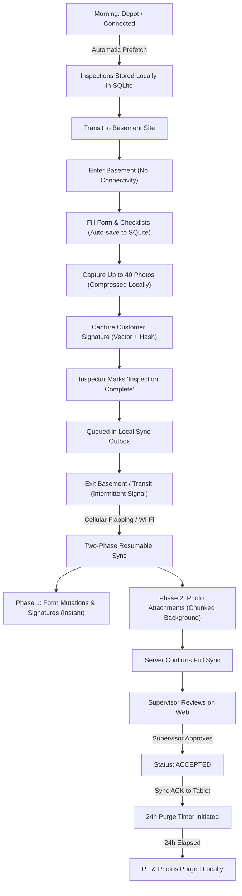
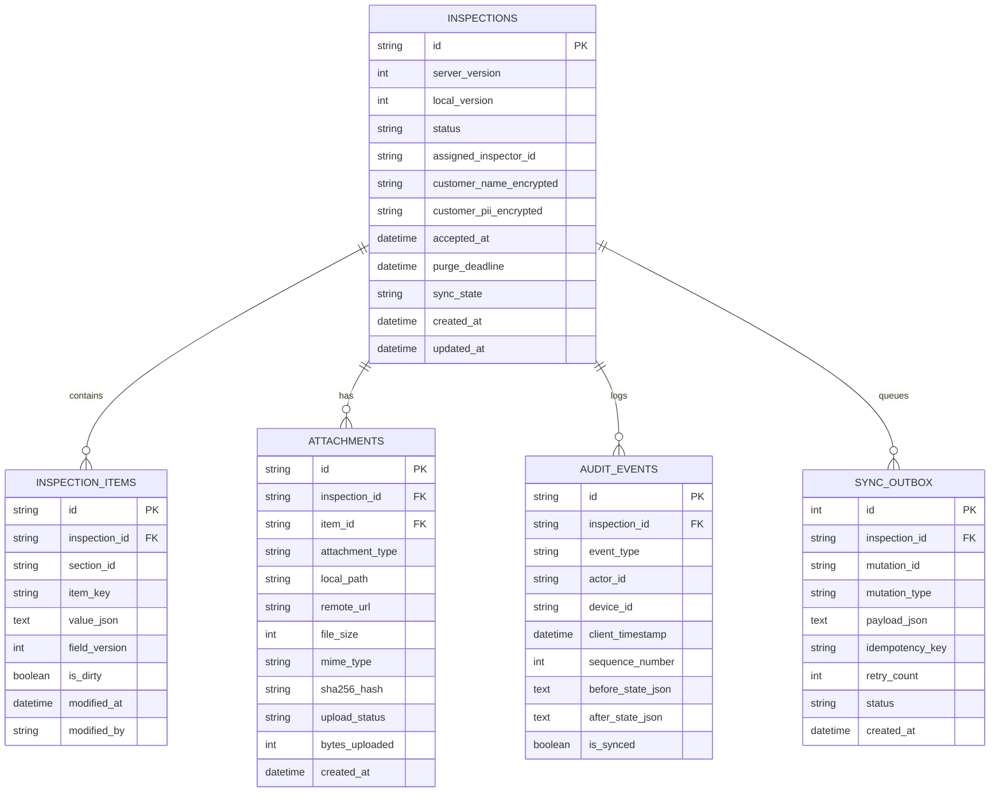
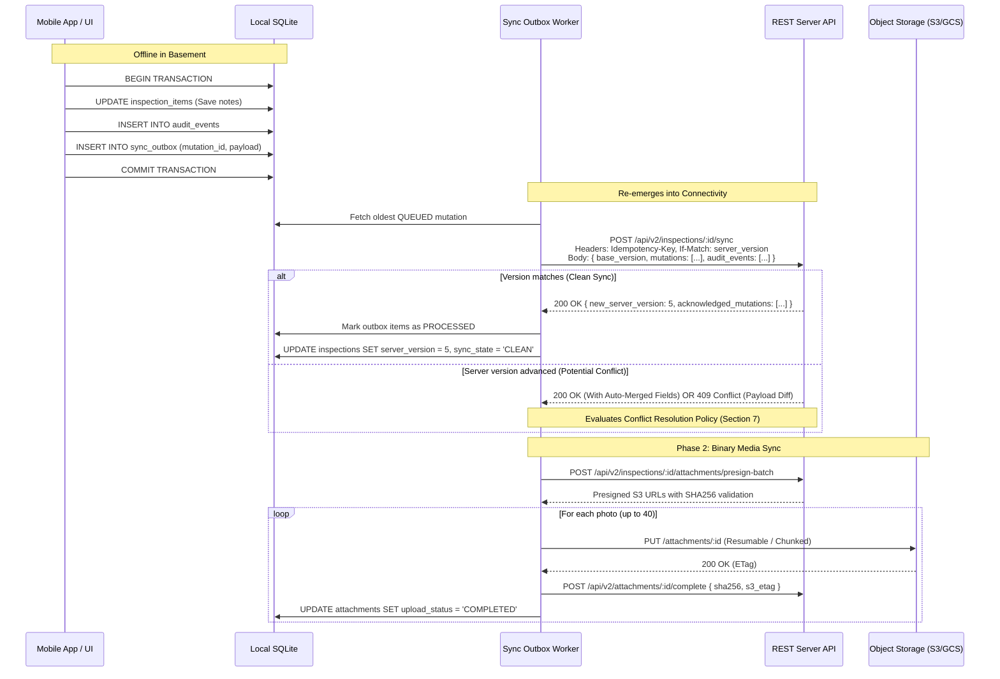
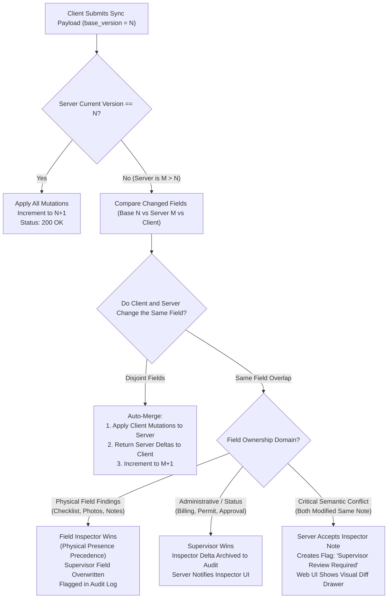
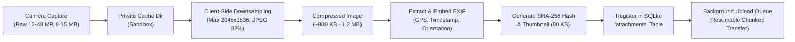
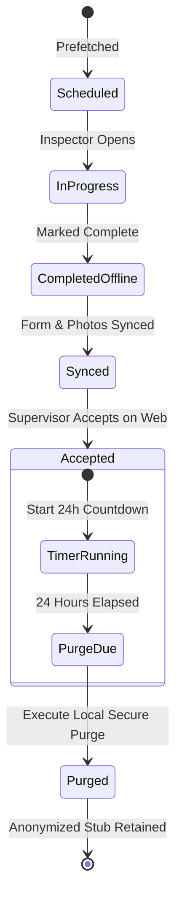
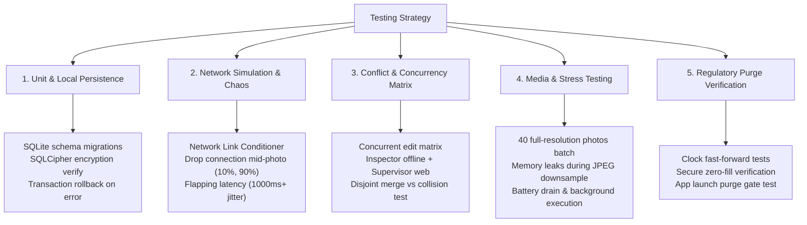
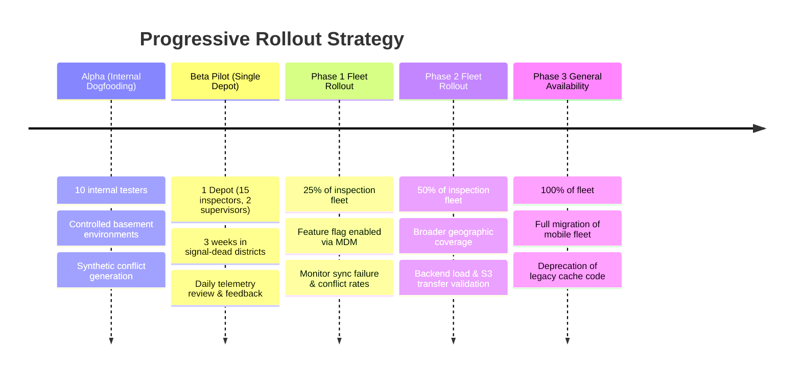
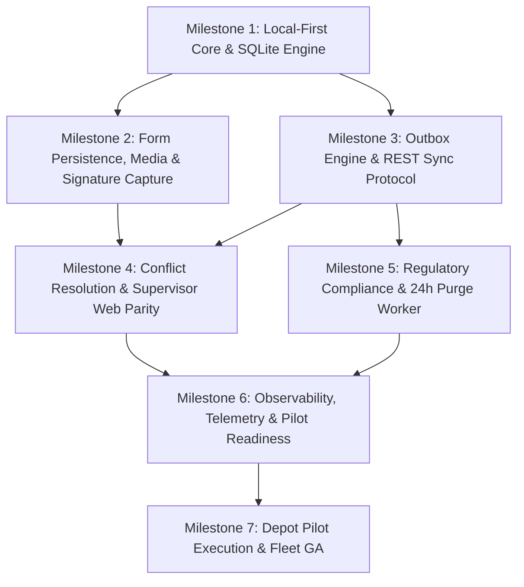

# Engineering & Product Plan: Offline Inspection & Synchronization

## 1. Executive Summary & Problem Context

Building inspectors operate company-managed tablets in signal-compromised environments (e.g., basements, sub-levels, reinforced concrete structures). The current architecture relies on a naive REST client where SQLite serves merely as an ephemeral read-through cache. Consequently, intermittent or dropped connections cause in-flight form entries and notes to be discarded, leading to inspector frustration, lost field time, and incomplete records.

This plan details the transition from an online-first architecture to a **Local-First, Outbox-Driven Architecture**. The mobile tablet becomes the authoritative source of truth during field operations, capturing checklist forms, up to 40 compressed photos, and customer signatures offline. Changes synchronize deterministically when connectivity returns. Concurrently, the architecture respects server integer record versioning, handles concurrent supervisor edits on the web without building an over-engineered real-time collaborative editor (CRDT/OT), maintains an immutable audit trail, and strictly enforces the regulatory requirement to purge local customer data within 24 hours of inspection acceptance.

---

## 2. Explicit Assumptions

To ensure clear alignment across product and engineering, the following baseline assumptions are established:

### 2.1 Hardware, OS & Device Management
1. **Device Fleet**: Inspectors use company-managed tablets (Android or iPadOS) enrolled in a centralized Mobile Device Management (MDM) platform enforcing device passcodes, OS updates, and remote wipe capabilities.
2. **Local Storage**: Tablets have at least 2 GB of available local flash storage to accommodate the SQLite database, application binaries, and a rolling buffer of cached attachments across active assignments.
3. **Hardware Cryptography**: Tablets support hardware-backed keystore services (Android Keystore / iOS Keychain) for storing cryptographic keys used for at-rest database and file encryption.

### 2.2 Operational & Business Workflows
1. **Assignment Model**: Inspections are assigned prior to the field shift. Inspectors know their route or schedule for the day, allowing predictable background prefetching.
2. **Supervisory Role**: Supervisors primarily perform reviews, reassignments, billing/permit verification, and status sign-offs via the web console. While concurrent edits are possible, simultaneous granular editing of the exact same checklist line item by both supervisor and inspector is an edge case rather than the standard workflow.
3. **Regulatory "Acceptance" Lifecycle**: The regulatory 24-hour clock begins strictly when an inspection transitions to the terminal status `ACCEPTED` (server-acknowledged), indicating that all review gates, sign-offs, and compliance checks have passed.
4. **Photo Requirements**: Each inspection requires up to 40 photos. Typical raw camera captures (12–48 MP) produce 5–15 MB per image (totaling up to 600 MB uncompressed), requiring mandatory client-side downscaling and compression before upload.

### 2.3 Technical & Infrastructure Constraints
1. **Existing Server Architecture**: The backend is a standard RESTful service using integer record versions (`version: 1, 2, ...`) for optimistic concurrency control. Backend modifications can introduce dedicated sync/outbox ingestion endpoints without requiring a complete rewrite of the web platform.
2. **Product Boundary**: Product has explicitly ruled out real-time collaborative editing (e.g., Google Docs-style operational transformation or complex CRDT trees). Conflict resolution must be pragmatic, deterministic, and asynchronous.
3. **Network Behavior**: Connectivity in the field is binary (basements have zero signal) or highly degraded/flapping (intermittent 3G/LTE at street level, captive portals). All networking code must assume TCP connections can reset mid-payload.

---

## 3. Scope Boundaries

### 3.1 In-Scope
* **Local-First Persistence**: Full offline capability for opening assigned inspections, filling multi-section forms, capturing notes, taking up to 40 photos, and capturing customer/inspector signatures.
* **SQLite Single Source of Truth**: Re-architecting the mobile SQLite layer from a passive cache into a transactional local datastore with an asynchronous mutation outbox.
* **Two-Phase Sync Engine**: Segregated sync protocol that transmits lightweight form mutations and audit entries first, followed by background, resumable attachment streaming.
* **Pragmatic Conflict Resolution**: Field-level partitioning and 3-way merge policies respecting integer versions and supervisor web workflows without complex collaborative editing.
* **Attachment Pipeline**: Client-side image compression, metadata indexing, resumable chunked uploads, and vector signature serialization.
* **Regulatory 24-Hour Purge**: Automated, secure local deletion of customer PII, signatures, and cached photos within 24 hours of inspection acceptance.
* **Audit Trail**: Tamper-evident local event logging synchronized with the server audit log.
* **Observability & Staged Rollout**: End-to-end sync telemetry, pilot depot deployment, feature flags, and rollback kill-switches.

### 3.2 Out-of-Scope
* **Peer-to-Peer Tablet Sync**: Direct device-to-device mesh sync between inspectors in the field.
* **Full Collaborative Rich-Text Editing**: Real-time collaborative typing or operational transformation (OT/CRDT) between web supervisor and tablet inspector.
* **Ad-Hoc Offline Property Creation**: Creating brand-new unassigned properties/inspections completely offline without pre-allocated server IDs (all work must be rooted in assigned inspections).
* **Complete Backend Database Re-architecture**: Replacing the relational database or REST paradigm on the server.

---

## 4. User Experience & Field Workflows



### 4.1 Phase 1: Pre-Shift Dispatch & Prefetch (Connected)
1. When connected to Wi-Fi or LTE at the depot/start of day, the mobile app automatically prefetches all scheduled and assigned inspections for the inspector.
2. The prefetch package bundles inspection metadata, existing property data, customer contact info, form schema definitions, and historical notes into SQLite.
3. **UI Indicator**: Each inspection card displays a sync badge:
   * `Ready for Offline` (green checkmark with storage footprint indicator, e.g., "Ready Offline (1.2 MB)").
   * If prefetch is in progress: `Downloading assignment data...`.
   * A manual `Prepare Shift Offline` button allows forcing an immediate full refresh.

### 4.2 Phase 2: In-Field Offline Operation (Basement / Zero Signal)
1. Upon losing connection, the tablet seamlessly switches to offline mode without modal popups or disruptive alerts. A persistent, non-intrusive banner appears: `Offline Mode — All changes saved locally`.
2. **Form Interaction**: Every field edit, checkbox toggle, and text note is written to SQLite within an atomic local transaction upon input blur / debounce. No data is held solely in UI state or memory.
3. **Photo Capture**: 
   * Camera integration stores raw images in private app sandbox.
   * Background thread compresses each image and generates a thumbnail.
   * UI displays a photo counter: `Photos: 23/40`.
   * Thumbnails display a local status icon (`Saved on device`).
4. **Signature Capture**:
   * The customer signs on the tablet screen.
   * Vector stroke paths, timestamp, customer name, and an SHA-256 state hash of the inspection content are saved to SQLite.
5. **Inspection Completion**:
   * Inspector taps `Complete Inspection`.
   * Client performs offline form validation. Once passed, the inspection transitions to `COMPLETED_PENDING_SYNC` and is locked against further edits.
   * Inspection is enqueued in the local `sync_outbox`.

### 4.3 Phase 3: Intermittent Connection & Sync
1. As the inspector moves between sites, the app detects intermittent network availability.
2. **Two-Phase Prioritization**:
   * **Phase 1 (Critical Data)**: Syncs small form mutations, status transitions, signature payloads, and audit logs over a single JSON request. This completes in milliseconds even on a brief 3G burst.
   * **Phase 2 (Bulk Attachments)**: Syncs photos sequentially or in parallel chunks via background transfer services.
3. **Visual Feedback**:
   * Sync drawer displays active progress: `Syncing Inspection #1042: Form synced, uploading photos (14/38)...`.
   * Inspectors can close the app or navigate away; background tasks continue uploading.

### 4.4 Phase 4: Post-Acceptance Regulatory Purge
1. Once the supervisor reviews and accepts the inspection on the web, the server marks `status = ACCEPTED`.
2. When the tablet reconnects, it receives the `ACCEPTED` acknowledgment with the authoritative acceptance timestamp (`accepted_at`).
3. The local client schedules a hard purge 24 hours post-acceptance:
   * PII fields in SQLite are scrubbed.
   * Customer signatures and local photo files are shredded/deleted.
   * Inspection card transforms into an archived receipt stub (`Accepted & Purged`).

---

## 5. Local Data Model & SQLite Architecture

Currently, the mobile app treats SQLite as a read-through cache. We transition SQLite to a **Local-First Single Source of Truth** with relational integrity, encryption, and transactional mutation queues.



### 5.1 Relational Schema Definitions

#### 1. `inspections`
* `id` (TEXT, PK): Unique UUID (originating from server).
* `server_version` (INTEGER): Integer record version known from last server fetch.
* `local_version` (INTEGER): Monotonically incremented counter for local offline changes.
* `status` (TEXT): `SCHEDULED`, `IN_PROGRESS`, `COMPLETED_PENDING_SYNC`, `SYNCED`, `ACCEPTED`, `ACCEPTED_PURGED`.
* `assigned_inspector_id` (TEXT): ID of assigned user.
* `property_address` (TEXT): Plaintext location info.
* `customer_pii_encrypted` (BLOB): Encrypted JSON containing customer name, phone, email, tenant notes.
* `accepted_at` (DATETIME, NULL): Timestamp when server confirmed `ACCEPTED`.
* `purge_deadline` (DATETIME, NULL): `accepted_at + 24 hours`.
* `sync_state` (TEXT): `CLEAN`, `DIRTY`, `SYNCING`, `ERROR`.

#### 2. `inspection_items`
* `id` (TEXT, PK): UUID.
* `inspection_id` (TEXT, FK -> `inspections.id` ON DELETE CASCADE).
* `section_id` (TEXT): Logical category (e.g., `roof`, `foundation`, `plumbing`, `electrical`).
* `item_key` (TEXT): Specific checklist identifier (e.g., `water_heater_pressure_valve`).
* `value_json` (TEXT): The value (e.g., `{"status": "FAIL", "severity": "HIGH", "notes": "Leak observed"}`).
* `field_version` (INTEGER): Local increment version for this specific field.
* `is_dirty` (INTEGER, BOOLEAN): `1` if modified locally and unacknowledged by server.
* `modified_at` (DATETIME): ISO8601 client timestamp.
* `modified_by` (TEXT): Inspector user ID.

#### 3. `attachments`
* `id` (TEXT, PK): UUID.
* `inspection_id` (TEXT, FK -> `inspections.id` ON DELETE CASCADE).
* `item_id` (TEXT, FK -> `inspection_items.id`, NULL allowed for general inspection photos).
* `attachment_type` (TEXT): `PHOTO` or `SIGNATURE`.
* `local_path` (TEXT): File path in app-private sandbox.
* `remote_url` (TEXT, NULL): Permanent S3/blob storage URL post-upload.
* `file_size` (INTEGER): Compressed size in bytes.
* `mime_type` (TEXT): `image/jpeg` or `application/json` (vector signature).
* `sha256_hash` (TEXT): Integrity checksum.
* `upload_status` (TEXT): `PENDING`, `UPLOADING`, `COMPLETED`, `FAILED`.
* `bytes_uploaded` (INTEGER): Offset for resumable transfers.

#### 4. `sync_outbox`
* `id` (INTEGER, PK AUTOINCREMENT): Strictly ordered FIFO queue.
* `inspection_id` (TEXT, FK -> `inspections.id`).
* `mutation_id` (TEXT, UNIQUE): Client UUID.
* `mutation_type` (TEXT): `PATCH_ITEMS`, `SIGN_INSPECTION`, `COMPLETE_INSPECTION`.
* `payload_json` (TEXT): Exact delta or mutation representation.
* `idempotency_key` (TEXT, UNIQUE): Dedup token sent in HTTP headers.
* `retry_count` (INTEGER): Number of transmission attempts.
* `status` (TEXT): `QUEUED`, `IN_FLIGHT`, `FAILED`.
* `created_at` (DATETIME): Enqueue timestamp.

#### 5. `audit_events`
* `id` (TEXT, PK): UUID.
* `inspection_id` (TEXT, FK -> `inspections.id`).
* `event_type` (TEXT): `FIELD_EDIT`, `PHOTO_TAKEN`, `SIGNATURE_CAPTURED`, `STATUS_CHANGE`, `DATA_PURGED`.
* `actor_id` (TEXT): Inspector ID.
* `device_id` (TEXT): Hardware/MDM identifier.
* `client_timestamp` (DATETIME): Time of event.
* `sequence_number` (INTEGER): Monotonic sequence per inspection.
* `before_state_json` (TEXT, NULL): Prior state for audit diffing.
* `after_state_json` (TEXT): New state.
* `is_synced` (INTEGER, BOOLEAN): `0` if not yet ingested by server audit log.

---

## 6. Sync Protocol & Mutation Engine

The sync protocol bridges offline mobile operations with existing RESTful server APIs using integer record versions.

### 6.1 Two-Phase Transactional Outbox Pattern



### 6.2 Protocol Endpoints & Payloads

#### 1. Batch Sync Endpoint
* **Endpoint**: `POST /api/v2/inspections/:id/sync`
* **Headers**: 
  * `X-Idempotency-Key: <uuid>`
  * `X-Device-ID: <device_uuid>`
* **Request Payload**:
```json
{
  "base_server_version": 4,
  "mutations": [
    {
      "mutation_id": "m-89b2c34a",
      "timestamp": "2026-10-11T10:15:30Z",
      "type": "UPDATE_ITEMS",
      "items": [
        {
          "item_key": "boiler_pressure",
          "value": {"psi": 32, "status": "WARN", "notes": "Slightly elevated"}
        }
      ]
    },
    {
      "mutation_id": "m-89b2c34b",
      "timestamp": "2026-10-11T10:45:12Z",
      "type": "SET_SIGNATURE",
      "signature": {
        "signer_name": "Jane Tenant",
        "role": "Tenant",
        "vector_data": "...",
        "content_hash": "sha256-abc12345..."
      }
    }
  ],
  "audit_events": [
    {
      "event_id": "aud-001",
      "type": "FIELD_EDIT",
      "sequence": 12,
      "timestamp": "2026-10-11T10:15:30Z",
      "field": "boiler_pressure",
      "new_value": "32 psi"
    }
  ]
}
```

* **Response Payload (Clean / Auto-merged)**:
```json
{
  "status": "APPLIED",
  "new_server_version": 5,
  "acknowledged_mutations": ["m-89b2c34a", "m-89b2c34b"],
  "server_state_deltas": []
}
```

### 6.3 Handling Integer Record Versions
The existing server uses integer versions (`version: 4`). 
1. The client always sends `base_server_version`.
2. If the server is still at version 4, it atomically executes the mutations, increments the record version to 5, and acknowledges the mutations.
3. If the server is at version 5 (due to a supervisor edit while the inspector was offline), the server does **not** blindly throw an unrecoverable 409 error. Instead, it evaluates the server's changes against the client's mutations using the **Conflict Resolution Policy** (Section 7).

---

## 7. Conflict Policy: Pragmatic Merging Without Real-Time Collaborative Editing

Product explicitly does not want a full collaborative editor (e.g., no OT/CRDTs). However, supervisors can edit the inspection from the web while inspectors are offline. A naive Last-Write-Wins (LWW) approach would wipe out either the inspector's detailed basement findings or the supervisor's admin notes.

We establish a **Domain-Partitioned 3-Way Merge Policy**:



### 7.1 Field-Level Ownership Partitioning
Every field in the inspection belongs to one of three domains:
1. **Inspector Physical Domain (Inspector Precedence)**:
   * Checklist answers, on-site measurements, inspection notes, photos, customer signature.
   * *Rule*: The inspector was physically on-site in the basement. If a supervisor on the web adjusted a checklist note while the inspector was underground, the inspector's direct observation takes precedence. The supervisor's edit is preserved in the audit log, and the supervisor is notified on the web.
2. **Supervisor Administrative Domain (Supervisor Precedence)**:
   * Assignment changes, billing codes, fee waivers, permit statuses, formal regulatory approvals.
   * *Rule*: Supervisor wins. The mobile client updates its local record to reflect the supervisor's administrative state.
3. **Status Transitions (State Machine Rules)**:
   * If a supervisor reassigns or cancels an inspection while an inspector is offline completing it:
     * The server **accepts and preserves** all the inspector's captured notes, photos, and signatures in a `SUBMITTED_DETACHED` state.
     * The inspection is flagged on the web dashboard: `Conflict: Inspector completed inspection after reassignment`.
     * Data is never silently discarded.

### 7.2 Web UI Conflict Reconciler
Instead of complex real-time collaborative text merge algorithms, the supervisor web portal receives a **Diff Drawer**:
* If a field-level collision occurs, the web portal alerts the supervisor: *"Inspector submitted notes for Section 3 that overwrite your edits made at 10:14 AM."*
* The supervisor can toggle between `[Inspector On-Site Finding]` and `[Supervisor Web Edit]`, with full audit traceability.

---

## 8. Attachment Handling: 40 Photos & Signatures

### 8.1 Photo Capture & Processing Pipeline

Handling 40 photos in an offline-to-online environment presents significant memory, bandwidth, and storage risks.



#### Optimization Specifications:
1. **Resolution & Compression**:
   * Downscale maximum dimension to 2048px (sufficient for high-detail building crack/leak inspections).
   * Apply JPEG compression at 82% quality.
   * Target size: **800 KB – 1.2 MB per photo**.
   * 40 photos total payload: **~35 MB – 48 MB** (down from ~400 MB raw).
2. **EXIF Metadata Integrity**:
   * Preserve hardware capture timestamp, camera orientation, and GPS coordinates (if GPS fix was acquired prior to entering basement).
3. **Storage Quota Enforcement**:
   * Strict application limit of 40 photos per inspection enforced in UI and SQLite schema (`COUNT(*) <= 40`).
   * Total disk cache reserved per active inspection: ~60 MB.

### 8.2 Resumable Binary Upload Strategy
1. **Direct-to-Object-Storage**: Attachments bypass the main API application server. The tablet obtains pre-signed URLs (S3/GCS) via `POST /api/v2/inspections/:id/attachments/presign-batch`.
2. **Resumable Chunked Transfers**:
   * Uses chunked uploads (e.g., TUS protocol or S3 Multipart Upload with 5 MB parts).
   * If an inspector walks through a basement doorway and loses cellular signal after uploading 75% of a photo, the upload pauses and resumes from the last byte offset upon reconnection.
3. **OS-Level Background Execution**:
   * Android: `WorkManager` with `Constraints.Builder().setRequiredNetworkType(NetworkType.CONNECTED).build()`.
   * iOS: `URLSessionConfiguration.backgroundSessionConfigurationWithIdentifier`.
   * Uploads continue even if the user minimizes or exits the application.

### 8.3 Digital Signature Handling
1. **Capture Format**:
   * Serialized vector paths (JSON array of coordinate strokes with pressure/timestamp points).
   * High-resolution rendered PNG thumbnail for visual inspection reports.
2. **Tamper-Evident Integrity Hash**:
   * At the moment of signing, the tablet computes `content_hash = SHA256(form_items + photo_hashes)`.
   * The signature record cryptographically seals the exact inspection state at that point in time.
3. **Payload Size**: Vector JSON + PNG is ~60 KB, packaged directly into the **Phase 1 primary sync payload** (ensuring the legal signature is synced immediately with the form data).

---

## 9. Security & Regulatory Compliance

### 9.1 Local Storage Encryption
1. **Database Encryption**: SQLite database is fully encrypted at rest using **SQLCipher (AES-256 in CBC mode)**.
2. **Key Storage**:
   * Encryption keys are generated cryptographically on the device and stored in the **hardware-backed Keystore** (Android Keystore / iOS Keychain).
   * Keys are non-exportable and protected by device passcode/biometrics.
3. **Sandbox Media Storage**:
   * Local photo files and signature PNGs are stored in private app storage (`/data/user/0/...` on Android; `Application Support` on iOS), protected by OS filesystem encryption.

### 9.2 Regulatory 24-Hour Post-Acceptance Purge Engine

**Regulatory Mandate**: Removal of local customer data within 24 hours after an inspection is accepted.



#### Purge Implementation Mechanics:
1. **Trigger Condition**:
   * The purge clock begins when the tablet receives confirmation from the server that `status = ACCEPTED` with a server-signed timestamp (`accepted_at`).
   * `purge_deadline = accepted_at + 24 hours`.
2. **The Purge Worker**:
   * Scheduled via OS background job scheduler (runs every 60 minutes and immediately upon every app launch).
   * When `currentTime >= purge_deadline`:
     1. **Database Scrubbing**:
        * Nullifies or overwrites all customer PII columns in `inspections` table (`customer_name`, `phone`, `email`, `tenant_notes`).
        * Deletes all rows in `attachments` and `inspection_items` associated with the inspection.
        * Executes `PRAGMA secure_delete = ON` and `VACUUM` to ensure freed SQLite database pages are zero-filled, preventing raw memory/disk forensics.
     2. **Filesystem Secure Shredding**:
        * Local photo files and signature PNGs are overwritten with random bytes and unlinked from the filesystem.
     3. **Audit Stub Conversion**:
        * The inspection record is replaced with an immutable, anonymized receipt:
          `{ id: "uuid", status: "ACCEPTED_PURGED", server_version: 6, accepted_at: "...", purged_at: "2026-10-12T14:00:00Z" }`.
3. **Offline Failsafe (Zero-Tolerance Enforcement)**:
   * If a tablet remains completely offline and never receives the server `ACCEPTED` signal, but the scheduled inspection date was over 7 days ago, a fallback policy flags the local record for inspection review.
   * If the tablet was notified of `ACCEPTED` and then disconnected, the 24-hour local hardware timer will trigger the purge **even if the device is 100% offline**.
4. **App Startup Verification Gate**:
   * On every application launch, before rendering any UI view, a synchronous purge gate executes: any inspection with `purge_deadline < now()` is scrubbed before the inspector can access any screen.

### 9.3 Tamper-Evident Audit History
* Every user action (open, edit, photo capture, delete, complete, purge) generates an entry in `audit_events`.
* Each entry contains: `event_id`, `inspection_id`, `actor_id`, `device_id`, `client_timestamp`, `sequence_number`, and payload diff.
* The sequence number is strictly monotonic. Gaps in sequence numbers indicate local tampering.
* Audit events are synced to the central server audit log and immutable WORM (Write Once Read Many) storage.

---

## 10. Migration & Backfill Strategy

The current production application uses SQLite as an ephemeral read-through cache and communicates with a REST API using integer record versions.

### 10.1 Mobile Client Migration (Cache to Local-First)
1. **Schema Initialization**:
   * Existing SQLite tables used for caching are deprecated.
   * Schema versioning is managed via `PRAGMA user_version`.
   * On app upgrade (v1.x -> v2.0):
     * Check if any unsynced requests exist in legacy cache (if any, flush to server before migrating).
     * Drop legacy read-through cache tables.
     * Execute DDL script to create encrypted tables (`inspections`, `inspection_items`, `attachments`, `sync_outbox`, `audit_events`).
2. **Backward Compatibility & Safe Hydration**:
   * Upon first launch of v2.0, perform a full hydration sync: query existing `GET /api/v1/inspections/assigned` and populate the new local SQLite store.

### 10.2 Server & API Evolution
1. **API Versioning**:
   * Existing endpoints (`GET /api/v1/inspections/:id`, `PUT /api/v1/inspections/:id`) remain unchanged to ensure older web supervisor clients and legacy mobile clients do not break.
   * Introduce v2 endpoints:
     * `POST /api/v2/inspections/:id/sync` (batch outbox ingestion).
     * `POST /api/v2/inspections/:id/attachments/presign-batch` (chunked S3 uploads).
     * `POST /api/v2/attachments/:id/complete` (attachment verification).
2. **Backfill of Existing Active Inspections**:
   * Database migration script on the server populates default integer record versions and initializes section/item-level hashes for all open inspections.
   * Add database triggers or middleware to write web supervisor edits to the new `audit_events` table.

---

## 11. Observability, Telemetry & Alerting

Comprehensive telemetry is required to detect synchronization failures, data loss, and regulatory non-compliance.

### 11.1 Mobile Client Telemetry (Buffered Offline)
Telemetry events are stored in a lightweight SQLite telemetry table and batched alongside sync payloads:
* `sync_duration_ms`: Latency of Phase 1 mutation syncs.
* `attachment_upload_duration_ms`: Per-photo upload duration and throughput (KB/s).
* `attachment_retry_count`: Number of retry attempts per photo.
* `offline_duration_minutes`: Time elapsed between network loss and reconnection.
* `outbox_depth`: Number of mutations waiting in queue.
* `purge_execution_latency_ms`: Duration of secure deletion routine.
* `purge_compliance_delta_hours`: Difference between `purge_deadline` and actual purge execution time.

### 11.2 Server-Side Metrics & SLIs/SLOs
* **Sync Error Rate**: Percentage of `POST /sync` requests resulting in 5xx or unresolvable 409s. (SLO: < 0.1%).
* **Conflict Frequency**: Percentage of syncs requiring 3-way field merge or supervisor diff alerts. (Baseline target: < 3%).
* **Attachment Orphan Rate**: Percentage of presigned attachments not finalized within 24 hours. (Target: < 0.5%).
* **Regulatory Compliance Rate**: Percentage of accepted inspections purged on devices within 24 hours. (SLO: **100%**).

### 11.3 Alerting Rules
* **P1 Alert**: Any device reports unpurged customer data where `now() > purge_deadline + 2 hours`.
* **P2 Alert**: Sync outbox queue depth on any active device exceeds 50 mutations without progress for > 4 hours while online.
* **P2 Alert**: Server conflict rate spikes above 10% in any 1-hour window.

---

## 12. Comprehensive Testing Strategy



### 12.1 Unit & Data Layer Testing
* **Transactional Integrity**: Test that power-off / process termination mid-write never leaves SQLite in a corrupt state; verify rollback of incomplete mutations.
* **SQLCipher Verification**: Direct hex-inspection of the SQLite database file on disk to verify that no plaintext PII strings leak into raw storage.

### 12.2 Network Chaos & Simulation Testing
* **Tools**: Network Link Conditioner, Toxiproxy, Charles Proxy.
* **Test Cases**:
  1. *Subway/Basement Tunnel Simulation*: Drop network exactly at HTTP request headers, mid-JSON payload, and mid-binary multipart chunk. Verify client outbox marks item `QUEUED` and retries with identical `Idempotency-Key` without duplicating records.
  2. *Flapping Connection*: 5 seconds online, 10 seconds offline cycle while synchronizing 40 photos. Verify all 40 photos eventually complete without re-uploading already completed chunks.

### 12.3 Conflict & Concurrency Simulation Matrix
* **Scenario A (Disjoint Fields)**: Inspector modifies Section 1 (Basement Foundation); Supervisor on web modifies Section 4 (Permit Code).
  * *Expected Result*: Server auto-merges; version increments; both updates accepted; zero inspector blocking.
* **Scenario B (Direct Field Collision)**: Inspector enters note "Boiler leaking" at 10:15 AM offline; Supervisor enters "Boiler replaced" at 10:20 AM on web.
  * *Expected Result*: Inspector physical finding takes precedence; supervisor edit archived in audit log; web UI presents diff flag to supervisor; inspector tablet sync succeeds without blocking.
* **Scenario C (Reassignment / Cancellation)**: Supervisor cancels inspection on web while inspector is completing it offline.
  * *Expected Result*: Inspection stored as detached completed record; supervisor alerted; inspector data never dropped.

### 12.4 Media Stress & Scale Testing
* Ingest 40 images taken with maximum camera hardware resolution (e.g. 48 MP raw) on low-end test tablets.
* Verify memory usage stays below 150 MB (using streaming/downsampling pipelines instead of loading full bitmaps into heap memory).
* Verify storage footprint stays within the ~50 MB compressed envelope.

### 12.5 Regulatory Purge Verification
* **Clock Fast-Forward Test**: Advance system clock on tablet by 25 hours after marking inspection `ACCEPTED`.
* Verify:
  * Customer PII fields are blanked.
  * Local photo files are unlinked and cannot be recovered via file recovery tools.
  * `PRAGMA secure_delete` zero-fill verified via raw disk block analysis.
  * Tablet logs `DATA_PURGED` audit event.

---

## 13. Staged Rollout & Pilot Plan

Product requirements dictate a pilot deployment before broad fleet rollout.



### 13.1 Stage 0: Alpha (Internal Dogfooding)
* Scope: Engineering, QA, and field leads (10 devices).
* Testing environment: Dedicated basement testing sites and signal-shielded enclosures.
* Focus: Validating battery consumption, photo compression performance, and edge-case conflict policies.

### 13.2 Stage 1: Depot Pilot (Beta)
* **Scope**: 1 designated district depot with known challenging reception (15 inspectors, 2 supervisors) for 3 full operational weeks.
* **Support Model**: Dedicated Slack channel between pilot inspectors, supervisors, and engineering team.
* **Pilot Gate & Exit Criteria**:
  1. **Zero Data Loss**: 100% of completed offline inspections successfully ingested by the server.
  2. **Attachment Success**: > 99.5% photo sync completion without manual inspector intervention.
  3. **Purge Compliance**: 100% compliance with 24-hour PII removal on pilot devices.
  4. **Inspector CSAT**: Inspector sentiment score >= 4.5/5 on usability and confidence in offline note retention.

### 13.3 Stage 2 & 3: Phased Fleet Rollout
* Controlled via remote configuration / feature flag (`offline_sync_v2_enabled`).
* **25% Fleet** (Week 1 post-pilot): Monitored for backend API load and S3 ingress concurrency.
* **50% Fleet** (Week 2 post-pilot): Expanded across multiple geographic regions.
* **100% Fleet** (Week 3 post-pilot): Full deployment.

---

## 14. Rollback Strategy & Emergency Failsafes

In the event of critical bugs (e.g., SQLite corruption, runaway upload loops, sync deadlocks), the system must degrade safely without stranding field inspectors.

### 14.1 Remote Kill-Switch Architecture
* A dynamic feature flag `offline_sync_mode` is evaluated at app launch and periodically:
  * `ENABLED` (Default v2 behavior: Local-first with outbox).
  * `SAFE_DRAIN` (App stops queuing new offline inspections, but processes all existing outbox items).
  * `DISABLED` (Reverts app to online-only read-through cache).

### 14.2 The Emergency Outbox Rescue Dump
* If the sync protocol encounters an unresolvable server deserialization error or unhandled schema bug, the client must **never** delete the inspector's offline work.
* **Emergency Endpoint**: `POST /api/v2/inspections/:id/emergency-rescue`
* If a mutation fails with unrecoverable errors after 10 retries, the app packages the entire raw SQLite row state, audit logs, and local photo files into an encrypted emergency `.tar.gz` bundle and pushes it to an emergency S3 triage bucket.
* An automated alert notifies engineering, allowing offline field data to be manually recovered and preventing inspectors from having to re-inspect buildings.

### 14.3 Database Downgrade Handling
* If the app binary must be downgraded:
  * The migration script checks `PRAGMA user_version`.
  * If a higher schema version is detected, it exports uncommitted outbox entries to a local emergency file before dropping tables or rolling back to legacy cache tables.

---

## 15. Milestone Sequence, Dependencies & Acceptance Criteria

To avoid fake calendar dates and unjustified staffing assumptions, milestones are defined strictly by logical execution sequence, explicit prerequisites, and unambiguous acceptance criteria.



### Milestone 1: Local-First Core & SQLite Engine
* **Prerequisites**: None.
* **Deliverables**:
  * Implement encrypted SQLCipher schema (`inspections`, `inspection_items`, `attachments`, `sync_outbox`, `audit_events`).
  * Implement transactional repository layer ensuring atomic multi-table writes.
  * Migration framework with `PRAGMA user_version` and legacy cache teardown.
* **Acceptance Criteria**:
  * Unit test suite verifies atomic rollback on simulated database crashes.
  * SQLCipher encryption verified via binary disk inspection (no plaintext strings).
  * 1,000 sequential form item writes execute locally in < 50ms.

### Milestone 2: Form Persistence, Media & Signature Capture
* **Prerequisites**: Milestone 1.
* **Deliverables**:
  * Refactor mobile UI to read/write exclusively to local SQLite.
  * Camera pipeline: client-side image downscaling (2048px, JPEG 82%), EXIF preservation, and SHA-256 generation.
  * Digital signature component: vector stroke capture + PNG rendering + tamper-evident state hash.
  * Enforce maximum 40 photos limit per inspection.
* **Acceptance Criteria**:
  * Inspector can fill an entire 50-item checklist, take 40 photos, and capture a signature in Airplane Mode with zero network calls.
  * Total disk usage for 40 photos does not exceed 50 MB.
  * Zero out-of-memory errors during rapid photo capture.

### Milestone 3: Outbox Engine & REST Sync Protocol
* **Prerequisites**: Milestone 1.
* **Deliverables**:
  * Client FIFO outbox worker with exponential backoff and jitter.
  * Server batch sync endpoints (`POST /api/v2/inspections/:id/sync`, `/attachments/presign-batch`, `/complete`).
  * Background upload service (Android WorkManager / iOS Background URLSession).
* **Acceptance Criteria**:
  * Form mutations sync successfully upon network restoration following an offline session.
  * Chunked photo upload resumes seamlessly from byte offset after simulated connection drop.
  * Server integer version increments accurately; idempotent retries produce zero duplicate records.

### Milestone 4: Conflict Resolution & Supervisor Web Parity
* **Prerequisites**: Milestones 2 and 3.
* **Deliverables**:
  * Server-side 3-way merge engine (domain partitioning: physical findings vs administrative).
  * Supervisor web diff drawer and notification banner for overlapping edits.
  * Non-blocking conflict handling ensuring field inspector uploads are never rejected.
* **Acceptance Criteria**:
  * Concurrently editing disjoint fields on web and mobile merges cleanly without manual intervention.
  * Overlapping edits on physical inspection findings prioritize inspector notes while preserving supervisor edits in the audit log.
  * Supervisor web UI displays visual diff drawer for any reconciled field conflicts.

### Milestone 5: Regulatory Compliance & 24h Purge Worker
* **Prerequisites**: Milestones 1 and 3.
* **Deliverables**:
  * Client-side background purge worker executing every 60 minutes and on app launch.
  * Cryptographic zeroization routine (`PRAGMA secure_delete = ON`, file shredding).
  * Server-acknowledged `ACCEPTED` timestamp synchronization and receipt stub generator.
* **Acceptance Criteria**:
  * Fast-forward clock test confirms 100% of customer PII and photo attachments are eradicated 24 hours after `ACCEPTED` status.
  * Memory/disk forensic analysis shows zero recoverable customer data from local storage post-purge.
  * Audit stub retained locally and `DATA_PURGED` event logged to server.

### Milestone 6: Observability, Telemetry & Pilot Readiness
* **Prerequisites**: Milestones 4 and 5.
* **Deliverables**:
  * Offline client telemetry buffer and sync logging.
  * Server dashboards for sync latency, conflict rates, and purge compliance.
  * Remote feature flags and emergency rescue dump endpoint.
* **Acceptance Criteria**:
  * Grafana/Datadog dashboard operational showing real-time sync metrics.
  * Remote kill-switch successfully toggles app between Local-First and Safe-Drain modes.
  * Emergency rescue dump pipeline verified with corrupted mock payloads.

### Milestone 7: Depot Pilot Execution & Fleet GA
* **Prerequisites**: Milestone 6.
* **Deliverables**:
  * Deploy beta build to single pilot depot (15 inspectors, 2 supervisors).
  * Execute 3-week pilot with real field inspections in basement environments.
  * Pilot review, metric sign-off, and progressive fleet rollout (25% -> 50% -> 100%).
* **Acceptance Criteria**:
  * Pilot meets all exit gates: 0% lost inspections, > 99.5% attachment sync rate, 100% 24h purge compliance.
  * Executive and compliance sign-off for general fleet availability.

---

## 16. Key Pre-Implementation Decisions & Recommendations

Before engineering starts implementation, the following foundational architecture decisions must be ratified:

### Decision 1: Conflict Resolution Strategy
* **Context**: Product wants no collaborative editor (CRDT/OT), yet supervisors edit on web while inspectors work offline.
* **Options Considered**:
  1. *Option A: Strict Last-Write-Wins (LWW) at Record Level*. Simple, but disastrous: either supervisor wipes hours of field notes, or inspector wipes supervisor approvals.
  2. *Option B: Lock Inspection on Checkout*. Prevents web edits while inspector is assigned. Rigid, causes operational bottlenecks if an inspector forgets to check in.
  3. *Option C (Recommended): Domain-Partitioned 3-Way Merge with Inspector Physical Precedence & Web Diff Drawer*.
* **Recommendation**: **Adopt Option C**. Partition fields into physical findings (inspector precedence) vs administrative (supervisor precedence). For direct collisions, the inspector's physical observation is committed to prevent field blocking, while the supervisor is presented with an asynchronous diff drawer on the web.

### Decision 2: Attachment Upload Protocol & Pipeline
* **Context**: Each inspection requires up to 40 photos under intermittent, low-bandwidth connections.
* **Options Considered**:
  1. *Option A: Base64 / Multipart Form Data through API Server*. Simple REST, but consumes heavy server CPU/RAM and chokes under connection drops.
  2. *Option B: Direct-to-Object-Storage via Presigned Resumable URLs (TUS / S3 Multipart)*.
* **Recommendation**: **Adopt Option B**. Client compresses images to ~1 MB, acquires presigned URLs, and uses OS background transfer services with resumable chunked streaming. This isolates large media traffic completely from the transactional REST API.

### Decision 3: Local Storage Encryption Architecture
* **Context**: Regulatory customer PII and photos stored locally on mobile devices.
* **Options Considered**:
  1. *Option A: Rely Solely on Standard OS File Protection / MDM Pin*. Low engineering effort, but fails compliance if device is unlocked or rooted.
  2. *Option B: Application-Level SQLCipher + Hardware Keystore*.
* **Recommendation**: **Adopt Option B**. Encrypt SQLite with SQLCipher AES-256 using keys stored in the Android Keystore / iOS Keychain. Photo files stored in private app sandbox. This guarantees compliance and zero plaintext disk exposure.

### Decision 4: Regulatory 24-Hour Purge Mechanism & Clock Authority
* **Context**: Mandatory removal of local customer data within 24 hours of inspection acceptance.
* **Options Considered**:
  1. *Option A: Server-Triggered Push Notification (Silent Push)*. Unreliable if tablet is turned off or in a dead zone when the notification fires.
  2. *Option B: Local Device Timer Baseline*. Vulnerable to manual device clock tampering.
  3. *Option C (Recommended): Hybrid Clock Authority with App Startup Purge Gate*.
* **Recommendation**: **Adopt Option C**. Tablet records server-provided `accepted_at` timestamp. Purge deadline is calculated as `accepted_at + 24 hours` using monotonic device uptime offset. Crucially, a synchronous purge gate executes on app launch, guaranteeing that expired data is erased before any UI is displayed.

### Decision 5: API Compatibility with Existing Integer Record Versions
* **Context**: Existing REST API uses integer record versions (`version: N`).
* **Options Considered**:
  1. *Option A: Rewrite Backend to Event Sourcing / CQRS*. Excessive scope, high risk.
  2. *Option B: Extend REST API with Batch Outbox Endpoint and Field Deltas*.
* **Recommendation**: **Adopt Option B**. Retain the integer record version at the root inspection entity. Add `POST /api/v2/inspections/:id/sync` accepting a batch of mutations with an `idempotency_key` and `base_server_version`. The server evaluates deltas, increments the integer version by 1, and acknowledges the mutations in a single transaction.
